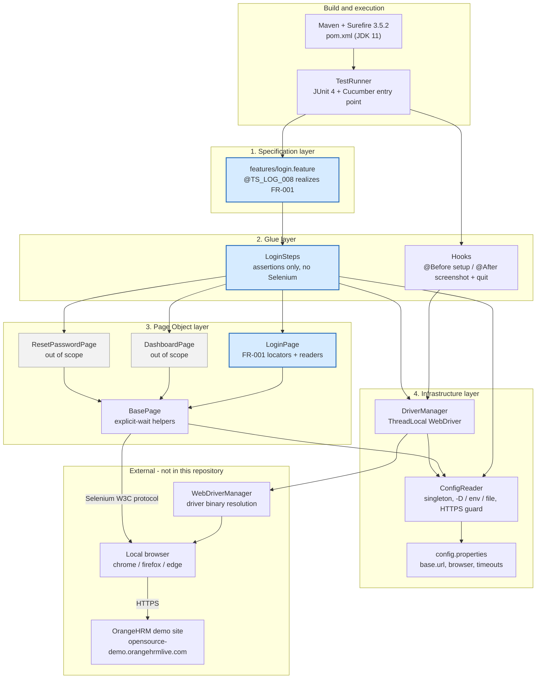
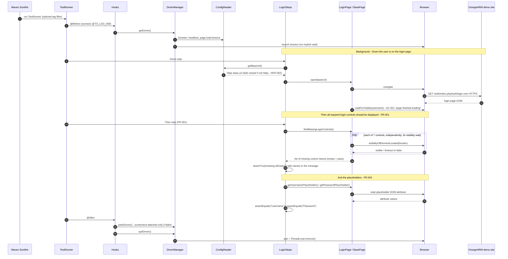

# Architecture

## Overview

This repository is a **Selenium + Java + Cucumber BDD test automation framework**
(Maven, JUnit 4, Page Object Model) that verifies the already-live, externally hosted
OrangeHRM demo application. There is no application-under-test source in this
repository, so "architecture" here means the layering of the *test* system — feature
specification, step glue, Page Objects, and driver/config infrastructure — and how
those layers realize the verification of `FR-001` (`AC-001`).

The architecture described below is **already implemented**. This document records and
validates it for the Design Review, Planner, Implementation, and Verify agents; it is
not a proposal for greenfield construction. Where the existing code could not be
reconciled with `artifacts/requirements.md`, the discrepancy is raised in
[Open Questions](#open-questions) rather than resolved by assumption.

## Architectural Goals and Drivers

| Driver | Source | Architectural consequence |
| --- | --- | --- |
| `FR-001` — login page displays all required controls (logo/branding, Username field, Password field, Login button, forgot-password link, footer copyright + social links) | `artifacts/requirements.md` § FR-001 | A single Page Object (`LoginPage`) owns all seven control locators; the step layer owns only assertions. Realized by scenario `@TS_LOG_008`. |
| `AC-001` — all controls **visible** after the page finishes loading | `artifacts/requirements.md` § AC-001 | Presence is insufficient: all checks use Selenium `visibilityOfElementLocated`, not `presenceOfElementLocated`. Page-load completion is established by `LoginPage.open()` waiting for the Username field before any control check runs. |
| Diagnosability of an `FR-001` failure | Derived from `AC-001` (six named controls in one criterion) | Controls are evaluated **independently** and the missing ones are collected into a list (`findMissingLoginControls()`), rather than short-circuiting one boolean — so the report names which control was absent. |
| Deterministic synchronization | `.claude/rules/tests.md` (determinism) | Explicit waits only; **no implicit wait** is configured anywhere, so a legitimate "not displayed" outcome does not pay a hidden implicit-wait cost. |
| `NFR-002` — HTTPS transport | `artifacts/requirements.md` § Out of Scope (tracked separately as `NFR-002`; **out of scope for `FR-001`**) | Already realized in code at two layers (`ConfigReader.getBaseUrl()` preventive guard, `LoginSteps` executed post-navigation scheme assertion). Documented here only to map existing code, not as an `FR-001` driver. See [Security Considerations](#security-considerations). |
| Out-of-scope behaviours (password masking, success/failure flows, forgot-password navigation) | `artifacts/requirements.md` § Out of Scope | Their Page Objects (`DashboardPage`, `ResetPasswordPage`) and locators already exist and remain in the architecture, but carry **no** `FR-001` trace. They are listed as supporting components with FR/NFR = `n/a (out of scope)`. |

## Recommended Architecture

A four-layer, one-way-dependency test architecture. Each layer may call only the layer
below it, which is what keeps `FR-001`'s verification expressible in one Gherkin
scenario and one Page Object method.

1. **Specification layer** — `login.feature`. Gherkin scenarios tagged `@TS_LOG_###`;
   the business-readable statement of `AC-001` lives here (`@TS_LOG_008`).
2. **Glue layer** — `LoginSteps` (step bindings) and `Hooks` (per-scenario lifecycle).
   Contains assertions and orchestration only; **zero** Selenium API calls, per the
   project convention in `.claude/CLAUDE.md`.
3. **Page Object layer** — `BasePage` + `LoginPage` / `DashboardPage` /
   `ResetPasswordPage`. Sole owner of locators, waits, and page interactions. All
   `FR-001` DOM knowledge is confined to `LoginPage`.
4. **Infrastructure layer** — `ConfigReader` (configuration + security guards),
   `DriverManager` (browser lifecycle), `config.properties`. Shared by all pages.

The **system under test is external and read-only** to this repository: the framework
never deploys, seeds, or mutates OrangeHRM. For `FR-001` the interaction is purely
observational (navigate, read visibility and placeholder attributes), which is why
`@TS_LOG_008` requires no credentials and no state cleanup.

## Component Diagram

Blue = components carrying an `FR-001` trace. Grey = components present in the
framework but outside `FR-001`'s scope.

## Key Components and Responsibilities

| Component | Responsibility | FR/NFR |
| --- | --- | --- |
| `src/test/resources/features/login.feature` (`@TS_LOG_008`) | Business-readable specification of `AC-001`: asserts all required controls displayed plus both placeholder values. Carries an inline `# FR-001` trace comment. | `FR-001` (`AC-001`) |
| `stepdefinitions/LoginSteps.all_required_login_controls_should_be_displayed()` | Fails the scenario when `findMissingLoginControls()` returns a non-empty list, embedding the missing control names in the assertion message. Tagged `// FR-001`. | `FR-001` |
| `stepdefinitions/LoginSteps.the_username_field_placeholder_should_be()` | Asserts the Username field's `placeholder` equals the expected value (`"Username"`). Tagged `// FR-001`. | `FR-001` |
| `stepdefinitions/LoginSteps.the_password_field_placeholder_should_be()` | Asserts the Password field's `placeholder` equals the expected value (`"Password"`). Tagged `// FR-001`. | `FR-001` |
| `pages/LoginPage.findMissingLoginControls()` | Evaluates the seven required controls independently (logo, username field, password field, Login button, forgot-password link, footer copyright, footer social link) and returns the names of those not visible. Single owner of `FR-001` locators. | `FR-001` |
| `pages/LoginPage.getUsernamePlaceholder()` / `getPasswordPlaceholder()` | Read the `placeholder` DOM attribute for the step layer to compare (no assertion in the page class). | `FR-001` |
| `pages/LoginPage.open(baseUrl)` | Navigates to `base.url` and waits for the Username field, establishing `AC-001`'s "page finishes loading" precondition before any control check. Bound to the `Background` step. | `FR-001` (`AC-001`) |
| `pages/BasePage` | Shared explicit-wait helpers (`waitForVisible`, `isDisplayed(locator, timeout)`, `isPresent`, `type`, `click`, `getText`). `isDisplayed` converts a `TimeoutException` into a first-class `false`, which is what makes "not displayed" a reportable outcome rather than an error. | `FR-001` (supporting) |
| `config/ConfigReader` | Thread-safe singleton; resolves every key with `-D` → environment variable → `config.properties` precedence. Supplies `base.url`, `explicit.wait`, `page.load.timeout`, `browser`, `headless`. | `FR-001` (supplies target URL and timeouts); `NFR-002` (HTTPS fail-closed guard in `getBaseUrl()`) |
| `driver/DriverManager` | Creates and disposes the browser session per thread via `ThreadLocal<WebDriver>`; applies the page-load timeout and deliberately applies **no implicit wait**; quits a partially initialised browser on configuration failure. | `FR-001` (supporting) |
| `hooks/Hooks` | `@Before` launches the driver before the first step; `@After` attaches a failure screenshot (best-effort, never masking the original failure) and always quits the driver. Guarantees a fresh, isolated session per scenario. | `FR-001` (diagnostics and isolation) |
| `runner/TestRunner` | JUnit 4 + Cucumber entry point; discovers `src/test/resources/features`, binds glue packages, emits pretty/HTML/JSON/JUnit-XML reports to `target/cucumber-reports/`. | `FR-001` (execution and reporting) |
| `src/test/resources/config.properties` | Declares the environment: `base.url` (the `.../auth/login` URL named in `AC-001`), `browser`, `headless`, `explicit.wait=15`, `page.load.timeout=30`, demo credentials. | `FR-001`; `NFR-002` |
| `config/ConfigReaderTest` | The only unit-test class. Covers `ConfigReader`'s security guards (HTTPS fail-closed, opt-out warning latch, demo-password host restriction) with system-property save/restore. | `NFR-002` (not `FR-001`) |
| `pages/DashboardPage` | Post-login landing-page assertions (URL fragment, header, user dropdown). | n/a — out of scope (AC2) |
| `pages/ResetPasswordPage` | Password-reset-request page assertions. | n/a — out of scope (AC4) |
| `pages/LoginPage` error/validation/loading/password-type readers | Support the out-of-scope negative, validation, masking, and loading-indicator scenarios. | n/a — out of scope (AC1.2, AC3, loading indicator) |

## Data Flow

`FR-001` / `AC-001` end-to-end, as currently implemented by `@TS_LOG_008`:

## Technology Choices

All choices below are **pre-existing and confirmed in the repository**, not new
proposals. Versions are from `pom.xml`.

| Decision | Choice | Rationale | Trade-offs |
| --- | --- | --- | --- |
| Browser automation | Selenium WebDriver 4.27.0 (`selenium-java`) | W3C-standard, cross-browser; the only way to assert *rendered visibility* of DOM controls as `AC-001` requires. | Slower and more environment-sensitive than API-level checks; `FR-001` genuinely needs a real renderer, so this is accepted. |
| Specification format | Cucumber JVM 7.20.1 (`cucumber-java`, `cucumber-junit`) | Gherkin keeps `AC-001` expressible almost verbatim as `@TS_LOG_008`, preserving requirement-to-test traceability for the pipeline. | Extra glue-maintenance layer; step-text drift can silently unbind a step. |
| Test runner | JUnit 4.13.2 via `@RunWith(Cucumber.class)` | Matches the existing suite and Surefire integration; `-Dcucumber.filter.tags` gives single-scenario runs. | JUnit 4 + `cucumber-junit` has **no parallel execution support**, so `DriverManager`'s thread safety is latent rather than exercised (see Scalability). |
| Design pattern | Page Object Model with an abstract `BasePage` | Confines all `FR-001` DOM/locator knowledge to `LoginPage`; a demo-site markup change is a one-file fix. | Indirection; risk of page classes accumulating unrelated readers (already visible in `LoginPage`, which also serves out-of-scope scenarios). |
| Synchronization | Explicit waits only (`WebDriverWait` in `BasePage`); no implicit wait | Deterministic, and makes a "not displayed" result cost exactly its own timeout instead of an invisible global one — essential for `FR-001`'s per-control checks. | Every new locator must choose a timeout deliberately; no global safety net. |
| Driver binaries | WebDriverManager 5.9.2 | Resolves and caches matching driver binaries automatically; no committed binaries, no manual PATH setup. | Needs network access on a cold cache; auto-resolution can surprise after a browser auto-update. |
| Configuration | `ConfigReader` singleton over `config.properties` with `-D` → env → file precedence | One mechanism covers local runs and CI secret injection with no code change; centralises the `NFR-002` HTTPS guard at the single point where `base.url` is read. | Global singleton state is shared across the Surefire JVM, which `ConfigReaderTest` must explicitly save/restore. |
| Build | Maven + Surefire 3.5.2, JDK 11 target | Standard, zero-install-step dependency resolution; Surefire `includes` deliberately narrowed to `**/TestRunner.java` and `**/*Test.java`. | JDK 11 forgoes newer language features. |
| Logging | SLF4J 2.0.16 + `slf4j-simple` | Minimal console diagnostics in `DriverManager`, `Hooks`, `ConfigReader` (including the `NFR-002` opt-out warning). | `slf4j-simple` offers no file appenders, routing, or log levels per package. |
| Reporting | Cucumber `pretty`, `summary`, HTML, JSON, JUnit-XML to `target/cucumber-reports/` + `Hooks` failure screenshots | JSON/XML are machine-readable for the Verify agent (Step 7); the screenshot plus the missing-control list makes an `FR-001` failure diagnosable without a re-run. | Reports are build-local artifacts; no history or trend retention. |

## SDLC Pipeline Components

| Type | Name | Purpose |
| --- | --- | --- |
| Agent | `.claude/agents/requirements.agent.md` (Step 1) | Produced the approved `artifacts/requirements.md` that drives this document. |
| Agent | `.claude/agents/architect.agent.md` (Step 2) | Owns this document; thin invoker that delegates to `design-architecture`. |
| Agent | `.claude/agents/design-review.agent.md` (Step 3) | Next gate; reviews this document and raises `DR-###` findings. |
| Agent | `.claude/agents/planner.agent.md` (Step 4) | Turns this architecture + `FR-001` into `TASK-###` items in `artifacts/impl-plan.md`. |
| Agent | `.claude/agents/implementation.agent.md` (Step 5) | Applies approved tasks to `src/`; gated by the pre-implementation hook. |
| Agent | `.claude/agents/review.agent.md` (Step 6) | Code review against `.claude/rules/code-quality.md` and `tests.md`. |
| Agent | `.claude/agents/verify.agent.md` (Step 7) | Executes the suite and writes `artifacts/verification-report.md`. |
| Agent | `.claude/agents/pr.agent.md` (Step 8) | Opens the PR and writes `artifacts/CHANGELOG.md`. |
| Skill | `design-architecture` | Owns this document's workflow and exact structure (source of truth for Step 2). |
| Skill | `sdlc-traceability` | `FR-###` / `NFR-###` / `DR-###` / `TASK-###` ID conventions and the chain enforced throughout this document. |
| Skill | `write-requirements`, `read-user-story` | Upstream (Step 1) inputs. |
| Skill | `design-review`, `plan-implementation`, `implement-task`, `code-review`, `verify-implementation`, `create-pr` | Downstream steps 3-8. |
| Rule | `.claude/rules/sdlc-artifacts.md` | Auto-applied to `artifacts/**/*.md`: stable IDs, Mermaid diagrams, `Not Found` over invention, confirmed-vs-assumed separation. Governs this file. |
| Rule | `.claude/rules/code-quality.md` | Auto-applied to `**/*.java` / `**/*.feature`: OWASP-safe, DRY, scope discipline. |
| Rule | `.claude/rules/tests.md` | Auto-applied to test sources: coverage from acceptance criteria, requirement IDs in test names/comments, determinism. |
| Hook | `.claude/hooks/pre_implementation.md` | Step 5 pre-flight gate: upstream artifacts exist and are approved, task is unblocked and requirement-backed, clean `git status` and build, `base.url` targets the intended host, no new hard-coded secret. |
| Command | `.claude/commands/orchestrator.prompt.md` | Pipeline entry point; drives the 8 steps and the human review gate per step. |
| State | `artifacts/ORCHESTRATION_LOG.md` | Per-step status, artifact, timestamps, and notes. |
| MCP server | `confluence` (`.mcp.json`, `mcp-atlassian`, stdio) | Source of the PRD (Confluence page 13271042) behind `FR-001`. Credentials come from `CONFLUENCE_*` environment variables, never committed. |
| MCP server | `github` (`.mcp.json`, HTTP) | PR/issue operations for Step 8; bearer token from `GITHUB_PERSONAL_ACCESS_TOKEN` environment variable. |

## Security Considerations

The framework holds no end-user data and exposes no attack surface of its own; its
security posture concerns **credential handling, transport, and target confinement**.

- **Transport (`NFR-002`, out of scope for `FR-001` but already implemented).** Two
  independent layers, by design:
  - *Preventive* — `ConfigReader.getBaseUrl()` parses `base.url` and throws
    `IllegalStateException` unless the **scheme** (not a substring) is `https`. This
    runs before the browser ever navigates, so it can actually prevent a cleartext
    submission. The sole opt-out is `allow.insecure.base.url=true`, documented for a
    local non-TLS sandbox only, left commented out in `config.properties`, and
    emitting a one-time `WARN` (key name only, never the `base.url` value) so a
    bypass is detectable after the fact.
  - *Executed* — the `the_current_page_should_be_served_over_https` step
    re-checks the live URL's scheme. On `@TS_LOG_008` this runs pre-submission;
    on `@TS_LOG_001` it necessarily runs after the password was already POSTed, so
    it is defence-in-depth against a mid-session downgrade, not prevention. The code
    comment states this limitation explicitly.
- **Credentials.** `valid.username` / `valid.password` in `config.properties` are
  OrangeHRM's **public demo values**, committed as a deliberate, scoped exception.
  `ConfigReader.getValidPassword()` enforces the scope in code: off the
  `opensource-demo.orangehrmlive.com` host it refuses the committed value and demands
  `-Dvalid.password` or `VALID_PASSWORD`. `FR-001`/`@TS_LOG_008` needs **no**
  credentials at all, so this risk is not on `FR-001`'s path.
- **Secret hygiene.** No secret is logged. MCP credentials are environment-variable
  placeholders in `.mcp.json`. The `-D` → env → file precedence means CI can inject
  secrets with no code or file change.
- **Authentication/authorisation of the framework itself.** Not applicable — the
  framework is a client; OrangeHRM owns authentication. Login-flow authentication
  behaviour (AC2/AC3) is explicitly out of `FR-001`'s scope.
- **Input validation.** All inputs are build-time configuration, not untrusted user
  input. `ConfigReader` fails closed on a missing key (`RuntimeException`) and treats
  a malformed or scheme-less URL as a guard failure rather than throwing from the URI
  parser.
- **Blast radius.** The target is a public demo instance and all `FR-001` interactions
  are read-only (navigate + read attributes), so a failing run cannot corrupt state.

## Reliability and Observability

- **Failure handling.** `BasePage.isDisplayed` catches `TimeoutException` and returns
  `false`, making "not displayed" a reportable `FR-001` outcome instead of an
  exception. `DriverManager.initDriver` quits a browser it started but had not yet
  registered in the `ThreadLocal`, preventing orphaned processes.
  `Hooks.tearDown` wraps screenshot capture in its own `try/catch` and quits the
  driver in a `finally`, so neither a crashed session nor a screenshot failure can
  mask the original scenario failure or leak a browser.
- **Isolation.** Hooks run per scenario, not per suite: every scenario gets a fresh
  browser session, so no leftover form state can hide a defect. `@TS_LOG_008` is
  consequently order-independent.
- **Retries.** There is **no** retry/rerun mechanism — deliberate for determinism
  (`.claude/rules/tests.md`): a flaky `FR-001` failure stays visible rather than being
  retried away. Recovery is to fix the locator or timeout, not to re-run.
- **Timeouts.** Default explicit wait 15 s (`explicit.wait`), page load 30 s
  (`page.load.timeout`), and a deliberately short 3 s per control in the `FR-001`
  missing-controls group — valid because `open()` already confirmed the page loaded.
- **Observability.** SLF4J console logging of scenario start/finish/status, browser
  init, and the `NFR-002` opt-out warning; Cucumber `pretty`/`summary` console output;
  HTML, JSON, and JUnit-XML reports under `target/cucumber-reports/`; PNG screenshots
  attached to the scenario on failure. An `FR-001` failure message carries the exact
  missing control names, so triage needs no re-run.
- **Gap.** No log file, no aggregation, no run-history retention. There is no
  "production" to monitor — the framework is run on demand.

## Scalability and Performance

- **`FR-001` happy path is fast.** All seven controls are already visible when the
  group runs (`open()` gated on the Username field), so each check resolves on its
  first poll.
- **Worst case is bounded and sequential.** The seven checks each use an independent
  3 s visibility wait, so an all-controls-missing failure costs up to ~21 s. This is
  the accepted price of naming *every* missing control instead of short-circuiting.
- **Primary bottleneck** is browser startup plus real network latency to the external
  demo site — both dominated by per-scenario session creation in `Hooks`, which is
  accepted in exchange for isolation.
- **Parallelism is prepared but not enabled.** `DriverManager` uses
  `ThreadLocal<WebDriver>` and `LoginSteps` holds no static state, so the design is
  thread-safe. However `pom.xml` sets no Surefire `parallel`/`forkCount`, and the
  JUnit 4 `@RunWith(Cucumber.class)` runner does not support parallel scenarios.
  Enabling parallelism would require migrating to `cucumber-junit-platform-engine`
  (JUnit 5) or the Cucumber CLI with a forked Surefire — **out of scope for `FR-001`**
  and noted here so no downstream agent assumes parallel execution already works.
  `ConfigReader`'s singleton is read-only after initialisation and safe under
  parallelism; `ConfigReaderTest`'s system-property mutation is the one component that
  would need isolation first.
- **Suite scale.** Twelve scenarios today; growth is linear. The architecture scales
  by adding scenarios and Page Objects, not by restructuring layers.

## Deployment

There is nothing to deploy — the framework is a **build-and-run test artifact**, and
the system under test is an externally operated site.

- **Build:** `mvn clean install -DskipTests` (JDK 11+, Maven). No virtual env or
  separate package step; Maven resolves everything from `pom.xml`.
- **Run:** `mvn test` from the repository root. Single scenario:
  `mvn test -Dcucumber.filter.tags="@TS_LOG_008"` (the `FR-001` scenario). Runtime
  overrides: `-Dbrowser=firefox -Dheadless=true`, `-Dvalid.username=... -Dvalid.password=...`.
- **Prerequisites:** a local browser matching `browser`, and network access to both
  the demo site and the WebDriverManager driver cache on a cold start.
- **Outputs:** `target/cucumber-reports/{cucumber-html-report.html, cucumber.json,
  cucumber-junit.xml}` plus embedded failure screenshots.
- **CI/CD:** **Not Found.** `.github/` contains only `modernize/java-upgrade`
  scaffolding — there is no workflow that builds or runs this suite, and no published
  report or artifact retention. `headless=true` and `-D` secret injection already make
  the framework CI-ready, so adding a workflow is a small, self-contained change.
  Raised as an open question below rather than assumed.

## Assumptions and Constraints

**Confirmed constraints (verified in the repository):**

- No application source under test lives here; the target is the live, externally
  hosted `https://opensource-demo.orangehrmlive.com` instance named in `AC-001`.
- All code is under `src/test/java` — there is no `src/main`. The Maven artifact is a
  test framework, not a deployable application.
- Step definitions must contain no direct Selenium calls; locators and waits live only
  in `pages/*` (project convention, `.claude/CLAUDE.md`).
- No implicit wait anywhere; explicit waits only.
- Surefire runs only `**/TestRunner.java` and `**/*Test.java`; `ConfigReaderTest` is
  the only unit test and is scoped to `ConfigReader`'s security guards, not general
  logic.
- `FR-001` is verified by exactly one scenario, `@TS_LOG_008`, and its three
  `// FR-001`-tagged step methods.

**Assumptions (not verifiable from this repository alone):**

- The demo site's hand-authored CSS class fragments used by the `FR-001` locators
  (`.orangehrm-login-branding img`, `.orangehrm-login-forgot-header`,
  `.orangehrm-login-footer .orangehrm-copyright-wrapper`,
  `.orangehrm-login-footer .orangehrm-login-footer-sm a`) remain stable. The code
  comments state these were confirmed against the live DOM, but the demo site is
  third-party and can change without notice — the single largest `FR-001` fragility.
- The demo site is reachable and not rate-limiting; `@TS_LOG_008` cannot pass offline,
  and this framework has no stub or recorded-DOM fallback.
- The copyright and social-link elements are inside the footer container that the
  locators are scoped to, so "footer is displayed" is inferred from its two children
  rather than asserted on the footer element itself.
- `FR-001`'s "footer" is treated as satisfied by one visible copyright element plus at
  least one visible social link (see Open Questions).

## Risks and Mitigations

| Risk | Likelihood | Impact | Mitigation |
| --- | --- | --- | --- |
| Third-party demo-site markup change breaks an `FR-001` locator | Medium | High — `@TS_LOG_008` fails with no product defect | Locators scoped to hand-authored `orangehrm-*` class fragments rather than generated `oxd-*` chains; all confined to `LoginPage`, so the fix is one file. Failure message names the exact control. |
| Demo site unreachable, slow, or rate-limiting | Medium | High — suite cannot run | 30 s page-load and 15 s explicit-wait timeouts fail fast with a clear message; failure screenshot distinguishes "site down" from "control missing". No mitigation for sustained outage (accepted: no stub layer). |
| `@TS_LOG_008` couples `FR-001` to the out-of-scope `NFR-002` HTTPS step | High (already the case) | Medium — an `NFR-002` regression reports as a failure of the `FR-001` scenario | Documented here and raised in Open Questions. Step-level reporting still identifies which step failed; splitting the step into its own scenario would fully decouple them. |
| `@TS_LOG_008`'s three `FR-001` assertions span two concerns (presence and placeholder text) | Confirmed | Low | Each is a separate step with its own assertion, so the report pinpoints which one failed. |
| Only one social link is asserted though `FR-001` says "social links" (plural) | Confirmed | Low-Medium — a partial footer regression could pass | Raised as Open Question 2 for the Design Review Agent to rule on; `waitForAllVisible` already exists in `BasePage` if a count assertion is wanted. |
| Code cites `AD-###` / `DR-###` / `TASK-###` IDs whose source documents are absent from `artifacts/` | Confirmed | Medium — broken traceability chain; risk of ID collision if new `AD-###` IDs are minted | This document mints **no** new `AD-###` IDs and preserves the cited ones verbatim with their inferred meaning; raised as Open Question 1. |
| Browser auto-update outpaces the driver binary | Low | Medium | WebDriverManager resolves matching binaries per run; `DriverManager` logs the browser and quits a half-initialised session. |
| Demo credentials repointed at a non-public environment | Low | High | `ConfigReader.getValidPassword()` refuses the committed value off the demo host; `pre_implementation.md` requires confirming `base.url` before any change. Not on `FR-001`'s path (it needs no credentials). |
| Latent parallelism assumed to be active | Medium | Low-Medium — misleading capacity expectations | Documented explicitly in Scalability: `ThreadLocal` is in place but the JUnit 4 runner and Surefire config do not execute scenarios in parallel. |

## Traceability

| FR/NFR | Architecture component | Specification | Code | Status |
| --- | --- | --- | --- | --- |
| `FR-001` (`AC-001`) | `LoginPage` (`findMissingLoginControls`, `getUsernamePlaceholder`, `getPasswordPlaceholder`, `open`) → `BasePage` → `DriverManager` / `ConfigReader` | `features/login.feature` `@TS_LOG_008` | `LoginSteps.all_required_login_controls_should_be_displayed()`, `.the_username_field_placeholder_should_be()`, `.the_password_field_placeholder_should_be()` (all tagged `// FR-001`) | Implemented — covered, no orphan |
| `NFR-002` | `ConfigReader.getBaseUrl()` (preventive guard); `LoginSteps.the_current_page_should_be_served_over_https()` (executed, defence-in-depth) | `@TS_LOG_008` and `@TS_LOG_001` (`# NFR-002` comments) | `ConfigReader`, `LoginSteps`, `ConfigReaderTest` | Implemented — **out of scope for `FR-001`**; mapped here for completeness only, per `artifacts/requirements.md` § Out of Scope |

Pre-existing decision/task IDs referenced by code comments, whose defining documents
are **not present** in `artifacts/`:

| ID cited in code | Cited at | Inferred meaning | Source document |
| --- | --- | --- | --- |
| `AD-008` | `LoginPage.java:33` | Footer locators keyed on stable hand-authored class fragments, not generated `oxd-*` chains | `Not Found` |
| `AD-009` | `LoginSteps.java:189` | The executed HTTPS scheme check is defence-in-depth, not prevention | `Not Found` |
| `DR-001` | `ConfigReaderTest.java:76` | `getBaseUrl()` fail-closed path | `Not Found` |
| `DR-002`, `DR-003` | `LoginPage.java:38,158` | Report every missing control, not a short-circuited boolean; single short timeout for the group | `Not Found` |
| `DR-017` | `ConfigReader.java:109` | Insecure opt-out must leave a detectable one-time trace | `Not Found` |
| `TASK-001`, `TASK-002`, `TASK-003`, `TASK-011` | `ConfigReaderTest.java:19,21,27,114`; `pom.xml:97` | HTTPS guard, shared-JVM test scoping, Surefire include pattern, opt-out warning latch | `Not Found` |

## Open Questions

1. **Orphaned `AD-###` / `DR-###` / `TASK-###` IDs.** Code and `pom.xml` reference
   `AD-008`, `AD-009`, `DR-001`, `DR-002`, `DR-003`, `DR-017`, and `TASK-001/002/003/011`,
   but `artifacts/` contains only `requirements.md` and `ORCHESTRATION_LOG.md` — the
   `architecture.md`, `design-review.md`, and `impl-plan.md` that defined those IDs are
   absent. Per the never-renumber rule this document deliberately **mints no new
   `AD-###` IDs** and only records the cited ones with their inferred meaning above.
   *Decision needed:* should Step 3/Step 4 (a) adopt this document as the new baseline
   and continue `AD-###` numbering from `AD-010` to avoid collision, (b) reconstruct
   the prior documents, or (c) renumber the code comments? **Do not** reuse
   `AD-001`-`AD-007` until their original meaning is known.
2. **Does `FR-001`'s "footer … social links" require more than one link?**
   `FR-001` and `AC-001` say "social links" (plural), but
   `findMissingLoginControls()` asserts visibility of a single
   `.orangehrm-login-footer .orangehrm-login-footer-sm a` match — so a regression that
   removed all but one social link would still pass. *Decision needed:* accept
   "at least one social link" as sufficient evidence the footer rendered, or tighten to
   an expected minimum count (`BasePage.waitForAllVisible` already supports this)?
   Not resolved here because it would change `FR-001`'s effective strictness.
3. **Should the `NFR-002` HTTPS step stay inside the `FR-001` scenario?**
   `@TS_LOG_008` ends with `And the current page should be served over HTTPS`, which
   `artifacts/requirements.md` places explicitly **out of scope** for `FR-001`. As
   written, an `NFR-002` regression fails the scenario that `FR-001` is traced to.
   *Decision needed:* leave it (pragmatic — the page is already open) or move it to a
   dedicated `NFR-002` scenario so each requirement has an independently failing test?
4. **Is the footer itself asserted, or only inferred?** No locator targets the
   `.orangehrm-login-footer` container directly; its presence is inferred from two
   descendants being visible. *Decision needed:* is child-element visibility accepted
   as satisfying `AC-001`'s "footer … are all visible", or should the container be
   asserted explicitly as an eighth control?
5. **Is the absence of CI intentional?** No workflow builds or runs this suite
   (`.github/` holds only `modernize/java-upgrade` scaffolding), so `FR-001` is verified
   only on demand locally. The framework is already CI-ready via `headless=true` and
   `-D` overrides. *Decision needed:* add a workflow in a later step, or is local,
   on-demand verification the accepted operating model for this capstone?
