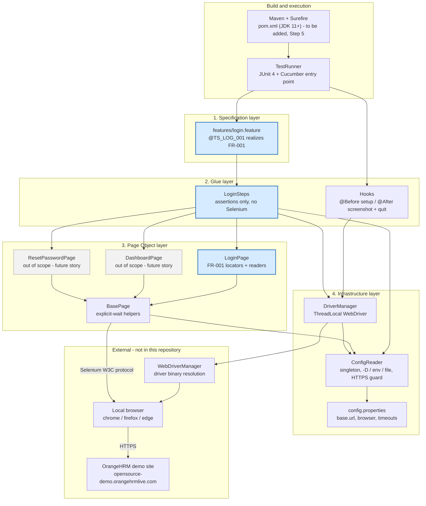
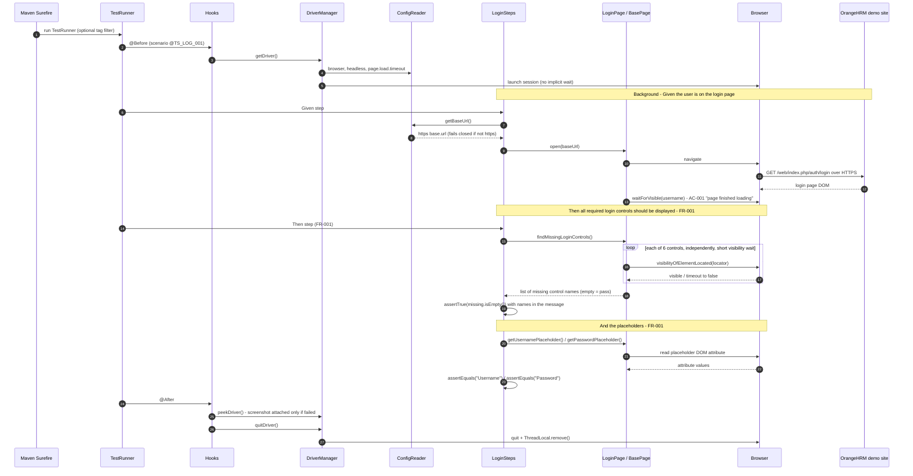

# Architecture

## Overview

This repository is a **Selenium + Java + Cucumber BDD test automation framework**
(Maven, JUnit 4, Page Object Model) that drives the already-live, externally hosted
OrangeHRM demo application. There is no application-under-test source in this
repository — "architecture" here means the layering of the *test* framework
(feature specification, step glue, Page Objects, driver/config infrastructure) that
will realize verification of `FR-001` (`AC-001`). This document is a **design
proposal for Step 5 (Implementation)**, not a record of existing code: on this
branch, no `pom.xml` or `src/` tree is present yet (confirmed via `git ls-files`), so
every component below is to be built, not already built. Where `.claude/CLAUDE.md`
already mandates a project convention (directory layout, class names, config
precedence), this document adopts it as a constraint rather than re-deriving it from
scratch.

## Architectural Goals and Drivers

| Driver | Source | Architectural consequence |
| --- | --- | --- |
| `FR-001` — login page displays all required controls (logo/branding, Username field, Password field, Login button, "Forgot your password?" link, footer with copyright + social links) | `artifacts/requirements.md` § FR-001 | A single Page Object (`LoginPage`) owns all six control locators; the step layer owns only assertions (`AD-002`). |
| `AC-001` — all controls **visible** after the page finishes loading | `artifacts/requirements.md` § AC-001 | Presence is insufficient: all checks must use Selenium `visibilityOfElementLocated`, not `presenceOfElementLocated`. Page-load completion is established by waiting for the Username field before any control check runs (`AD-003`). |
| Diagnosability of an `FR-001` failure (six named controls in one criterion) | Derived from `AC-001` | Controls are evaluated **independently**; missing ones are collected into one list rather than short-circuiting on the first failure, so the failure message names every missing control (`AD-006`). |
| Deterministic synchronization | `.claude/rules/tests.md` (determinism) | Explicit waits only; **no implicit wait**, so a legitimate "not displayed" outcome does not pay a hidden implicit-wait cost (`AD-003`). |
| Mandated project structure and conventions (Page Object Model, no Selenium calls in step defs, `ConfigReader`/`DriverManager`/`Hooks` names and responsibilities) | `.claude/CLAUDE.md` § Application architecture / Key conventions | Adopted as binding constraints, not re-derived (`AD-001`, `AD-002`, `AD-004`, `AD-005`). |
| HTTPS transport guard referenced as `NFR-002` | `.claude/CLAUDE.md` § Configuration (`getBaseUrl()` fails closed unless scheme is `https`) | Adopted as a `ConfigReader` design constraint (`AD-004`) because it is an existing, binding project convention. **Not** claimed as satisfying an approved non-functional requirement: `artifacts/requirements.md` names `NFR-002` only once, inside § Out of Scope, as a pointer to work "tracked separately" — no `NFR-002` statement, measurable target, or acceptance criterion exists in any approved artifact, and no `NFR-001` exists either. See [Open Questions](#open-questions). |
| Reporting that lets Step 7 (Verify) and a human triage an `FR-001` failure without re-running | Derived from the pipeline's gated, artifact-driven workflow (`.claude/CLAUDE.md` § Agentic SDLC pipeline) | Multi-format Cucumber reports plus failure screenshots (`AD-007`). |

## Recommended Architecture

A four-layer, one-way-dependency test architecture, matching `.claude/CLAUDE.md`'s
mandated structure. Each layer may call only the layer below it, which keeps
`FR-001`'s verification expressible in one Gherkin scenario and one Page Object
method.

1. **Specification layer** — `login.feature`. Gherkin scenarios tagged
   `@TS_LOG_###`; the business-readable statement of `AC-001` lives here as the
   first scenario, `@TS_LOG_001`.
2. **Glue layer** — `LoginSteps` (step bindings) and `Hooks` (per-scenario
   lifecycle). Contains assertions and orchestration only; **zero** Selenium API
   calls, per `.claude/CLAUDE.md`.
3. **Page Object layer** — `BasePage` + `LoginPage` (and, as placeholders for
   already-anticipated, explicitly out-of-scope follow-on stories named in
   `.claude/CLAUDE.md`, `DashboardPage` / `ResetPasswordPage`). Sole owner of
   locators, waits, and page interactions. All `FR-001` DOM knowledge is confined
   to `LoginPage`.
4. **Infrastructure layer** — `ConfigReader` (configuration + security guards),
   `DriverManager` (browser lifecycle), `config.properties`. Shared by all pages.

The **system under test is external and read-only** to this repository: the
framework never deploys, seeds, or mutates OrangeHRM. For `FR-001` the interaction
is purely observational (navigate, read visibility and placeholder attributes),
so `@TS_LOG_001` needs no credentials and no state cleanup.

## Component Diagram

Blue = components that will carry an `FR-001` trace. Grey = components named by
`.claude/CLAUDE.md`'s target structure but outside `FR-001`'s scope (future
stories: AC2 successful login, AC4 password-recovery navigation).

## Key Components and Responsibilities

| Component | Responsibility | FR/NFR |
| --- | --- | --- |
| `src/test/resources/features/login.feature` (`@TS_LOG_001`) | Business-readable specification of `AC-001`: asserts all six required controls are displayed plus both placeholder values. Carries an inline `# FR-001` trace comment. (`AD-001`, `AD-006`) | `FR-001` (`AC-001`) |
| `stepdefinitions.LoginSteps` — "all required login controls should be displayed" step | Fails the scenario when the Page Object's missing-controls check returns a non-empty list, embedding the missing control names in the assertion message. Tagged `// FR-001`. (`AD-002`, `AD-006`) | `FR-001` |
| `stepdefinitions.LoginSteps` — Username/Password placeholder steps | Assert the Username field's placeholder equals `"Username"` and the Password field's placeholder equals `"Password"`. Tagged `// FR-001`. (`AD-002`) | `FR-001` |
| `pages.LoginPage` — missing-controls check | Evaluates all six required controls (logo, username field, password field, Login button, forgot-password link, footer copyright + social links) independently and returns the names of those not visible. Sole owner of `FR-001` locators. (`AD-002`, `AD-006`) | `FR-001` |
| `pages.LoginPage` — placeholder readers | Read the `placeholder` DOM attribute for the step layer to compare; no assertion lives in the page class. (`AD-002`) | `FR-001` |
| `pages.LoginPage.open(baseUrl)` | Navigates to `base.url` and waits for the Username field, establishing `AC-001`'s "page finishes loading" precondition before any control check runs. Bound to the `Background` step. (`AD-003`) | `FR-001` (`AC-001`) |
| `pages.BasePage` | Shared explicit-wait helpers (visibility checks that convert a `TimeoutException` into a first-class `false`, so "not displayed" is a reportable outcome rather than a thrown error). (`AD-003`) | `FR-001` (supporting) |
| `config.ConfigReader` | Thread-safe singleton; resolves every key with `-D` → environment variable → `config.properties` precedence. Supplies `base.url`, `explicit.wait`, `page.load.timeout`, `browser`, `headless`. Fails closed on a non-`https` `base.url` (HTTPS guard adopted from `.claude/CLAUDE.md`; see [Open Questions](#open-questions) on `NFR-002`'s undefined status). (`AD-004`) | `FR-001` (supplies target URL and timeouts); HTTPS guard referenced as `NFR-002` by convention, **not** by an approved requirement |
| `driver.DriverManager` | Creates and disposes the browser session per thread via `ThreadLocal<WebDriver>`; applies the page-load timeout; deliberately applies **no** implicit wait. (`AD-005`) | `FR-001` (supporting) |
| `hooks.Hooks` | `@Before` launches the driver before the first step; `@After` attaches a failure screenshot (best-effort, never masking the original failure) and always quits the driver. Guarantees a fresh, isolated session per scenario. (`AD-005`, `AD-007`) | `FR-001` (diagnostics and isolation) |
| `runner.TestRunner` | JUnit 4 + Cucumber entry point; discovers `src/test/resources/features`, binds glue packages, emits pretty/HTML/JSON/JUnit-XML reports. (`AD-001`, `AD-007`) | `FR-001` (execution and reporting) |
| `src/test/resources/config.properties` | Declares the environment: `base.url` (the `.../auth/login` URL named in `AC-001`), `browser`, `headless`, `explicit.wait`, `page.load.timeout`. (`AD-004`) | `FR-001` |
| `pages.DashboardPage`, `pages.ResetPasswordPage` | Placeholders for the already-named future stories (AC2 successful login, AC4 password-recovery navigation) per `.claude/CLAUDE.md`'s target structure. Not required to implement `FR-001`. | n/a — out of scope |

## Data Flow

Proposed `FR-001` / `AC-001` end-to-end flow, to be realized by scenario
`@TS_LOG_001` in Step 5:

## Technology Choices

No `pom.xml` exists on this branch yet (`Not Found`), so the choices below are
**recommendations for Step 5**, not confirmed repository facts. They follow
`.claude/CLAUDE.md`'s mandated stack and the "JDK 11+ and Maven" constraint.

| Decision | Choice | Rationale | Trade-offs |
| --- | --- | --- | --- |
| `AD-001` Browser automation + specification stack | Selenium WebDriver (4.x) + Cucumber-JVM (7.x, `cucumber-java`/`cucumber-junit`) + JUnit 4, built with Maven | Selenium is the only way to assert *rendered visibility* of DOM controls as `AC-001` requires; Cucumber keeps `AC-001` expressible almost verbatim as a Gherkin scenario, preserving requirement-to-test traceability. | Selenium is slower and more environment-sensitive than API-level checks, but `FR-001` genuinely needs a real renderer. Cucumber adds a glue-maintenance layer; step-text drift can silently unbind a step. |
| `AD-002` Design pattern | Page Object Model with an abstract `BasePage`; zero Selenium calls in step definitions | Confines all `FR-001` DOM/locator knowledge to `LoginPage`; a demo-site markup change is a one-file fix. Matches `.claude/CLAUDE.md`'s "Which file to extend" convention. | Indirection; risk of page classes accumulating unrelated readers as later stories are added. |
| `AD-003` Synchronization | Explicit waits only (`WebDriverWait` in `BasePage`); no implicit wait configured anywhere | Deterministic, and makes a "not displayed" result cost exactly its own timeout instead of an invisible global one — essential for `FR-001`'s per-control checks. | Every new locator must choose a timeout deliberately; no global safety net. |
| `AD-004` Configuration | `ConfigReader` singleton over `config.properties` with `-D` → env → file precedence; HTTPS fail-closed guard on `base.url` | One mechanism covers local runs and CI secret injection with no code change; centralizes the HTTPS guard mandated by `.claude/CLAUDE.md` at the single point where `base.url` is read. | Global singleton state would need explicit save/restore in any unit test that mutates system properties. The HTTPS guard is adopted as a convention, not as proof of an approved `NFR-002` (see Open Questions). |
| `AD-005` Driver lifecycle | `DriverManager` with `ThreadLocal<WebDriver>`, created/torn down per scenario by `Hooks` | Thread-safe by construction, preparing for parallel execution later without a redesign; per-scenario isolation means no leftover form state can hide a defect. | Parallel execution is not automatically exercised by the JUnit 4 + `cucumber-junit` runner (see Scalability); per-scenario browser launch dominates runtime. |
| `AD-006` Failure reporting strategy | Evaluate all `FR-001` controls independently per scenario run; collect missing-control names into one assertion rather than short-circuiting | Makes an `FR-001` failure diagnosable without a re-run — the message names exactly which control is absent. | Worst case (all controls missing) costs the sum of each control's own short timeout rather than one timeout. |
| `AD-007` Reporting and diagnostics | Cucumber `pretty`/`summary` console + HTML/JSON/JUnit-XML reports; `Hooks` attaches a failure screenshot | JSON/XML are machine-readable for the Verify agent (Step 7); the screenshot plus the missing-control list makes an `FR-001` failure diagnosable without a re-run. | Reports are build-local artifacts; no history or trend retention. |
| Driver binaries | WebDriverManager (5.x) | Resolves and caches matching driver binaries automatically; no committed binaries, no manual PATH setup. | Needs network access on a cold cache; auto-resolution can surprise after a browser auto-update. |
| Logging | SLF4J + a simple binding | Minimal console diagnostics in `DriverManager`, `Hooks`, `ConfigReader`. | A simple binding offers no file appenders, routing, or per-package log levels; acceptable for a demo-scale suite. |
| Build | Maven + Surefire, JDK 11 target | Matches `.claude/CLAUDE.md`'s stated setup (`mvn clean install -DskipTests`, `mvn test`); Surefire should be scoped to `**/TestRunner.java` and `**/*Test.java` only, per convention. | JDK 11 forgoes newer language features. |

## SDLC Pipeline Components

| Type | Name | Purpose |
| --- | --- | --- |
| Agent | `.claude/agents/requirements.agent.md` (Step 1) | Produced the approved `artifacts/requirements.md` that drives this document. |
| Agent | `.claude/agents/architect.agent.md` (Step 2) | Owns this document; thin invoker that delegates to `design-architecture`. |
| Agent | `.claude/agents/design-review.agent.md` (Step 3) | Next gate; reviews this document and raises `DR-###` findings. |
| Agent | `.claude/agents/planner.agent.md` (Step 4) | Turns this architecture + `FR-001` into `TASK-###` items in `artifacts/impl-plan.md`. |
| Agent | `.claude/agents/implementation.agent.md` (Step 5) | Builds `src/` (currently absent on this branch) from approved tasks; gated by `.claude/hooks/pre_implementation.md`. |
| Agent | `.claude/agents/review.agent.md` (Step 6) | Code review against `.claude/rules/code-quality.md` and `tests.md`. |
| Agent | `.claude/agents/verify.agent.md` (Step 7) | Executes the suite and writes `artifacts/verification-report.md`. |
| Agent | `.claude/agents/pr.agent.md` (Step 8) | Opens the PR and writes `artifacts/CHANGELOG.md`. |
| Skill | `design-architecture` | Owns this document's workflow and exact structure (source of truth for Step 2). |
| Skill | `sdlc-traceability` | `FR-###` / `NFR-###` / `AD-###` / `DR-###` / `TASK-###` ID conventions and the chain enforced throughout this document. |
| Skill | `write-requirements`, `read-user-story` | Upstream (Step 1) inputs. |
| Skill | `design-review`, `plan-implementation`, `implement-task`, `code-review`, `verify-implementation`, `create-pr` | Downstream steps 3-8. |
| Rule | `.claude/rules/sdlc-artifacts.md` | Auto-applied to `artifacts/**/*.md`: stable IDs, Mermaid diagrams, `Not Found` over invention, confirmed-vs-assumed separation. Governs this file. |
| Rule | `.claude/rules/code-quality.md` | Auto-applied to `**/*.java` / `**/*.feature`: OWASP-safe, DRY, scope discipline; explicit HTTPS/masking/generic-error guidance for the login use case. |
| Rule | `.claude/rules/tests.md` | Auto-applied to test sources: coverage from acceptance criteria, requirement IDs in test names/comments, determinism. |
| Hook | `.claude/hooks/pre_implementation.md` | Step 5 pre-flight gate: upstream artifacts exist and are approved, task is unblocked and requirement-backed, clean `git status` and build, `base.url` targets the intended host, no new hard-coded secret. |
| Command | pipeline entry point (`/orchestrator.prompt`) | Drives the 8 steps and the human review gate per step. |
| State | `artifacts/ORCHESTRATION_LOG.md` | Per-step status, artifact, timestamps, and notes. |

## Security Considerations

The framework will hold no end-user data and exposes no attack surface of its own;
its security posture concerns **credential handling, transport, and target
confinement**.

- **Transport.** The HTTPS fail-closed guard in `ConfigReader.getBaseUrl()`
  (adopted from `.claude/CLAUDE.md`) is **preventive**: it should reject a
  non-`https` `base.url` before the browser ever navigates, with a documented,
  logged (never value-logging) opt-out for a local non-TLS sandbox only. This is a
  project convention, not yet a defined, approved `NFR-002` — see
  [Open Questions](#open-questions).
- **Credentials.** Any demo credentials used by future (out-of-scope) scenarios
  must be resolved through `ConfigReader`'s `-D` → env → file precedence, never
  hard-coded in step definitions or logged. `FR-001`/`@TS_LOG_001` needs **no**
  credentials at all, so this risk is not on `FR-001`'s path. Per
  `.claude/rules/code-quality.md`, any future login-credential handling must mask
  passwords, never transmit or store them in plain text outside the HTTPS request
  itself, and keep any error message generic.
- **Secret hygiene.** No secret should be logged at any layer. The `-D` → env →
  file precedence means CI can inject secrets with no code or file change.
- **Authentication/authorization of the framework itself.** Not applicable — the
  framework is a client; OrangeHRM owns authentication. Login-flow authentication
  behavior (AC2/AC3) is explicitly out of `FR-001`'s scope.
- **Input validation.** All inputs are build-time configuration, not untrusted
  user input. `ConfigReader` should fail closed on a missing key and treat a
  malformed or scheme-less URL as a guard failure.
- **Blast radius.** The target is a public demo instance and all `FR-001`
  interactions are read-only (navigate + read attributes), so a failing run
  cannot corrupt state.

## Reliability and Observability

- **Failure handling.** `BasePage`'s visibility helper should catch
  `TimeoutException` and return `false`, making "not displayed" a reportable
  `FR-001` outcome instead of an exception. `DriverManager` should quit a browser
  it started but had not yet registered, preventing orphaned processes.
  `Hooks.tearDown` should wrap screenshot capture in its own `try/catch` and quit
  the driver in a `finally`, so neither a crashed session nor a screenshot
  failure can mask the original scenario failure or leak a browser.
- **Isolation.** Hooks run per scenario, not per suite: every scenario gets a
  fresh browser session, so no leftover form state can hide a defect.
  `@TS_LOG_001` is consequently order-independent.
- **Retries.** No retry/rerun mechanism — deliberate for determinism
  (`.claude/rules/tests.md`): a flaky `FR-001` failure should stay visible rather
  than be retried away.
- **Timeouts.** Explicit wait and page-load timeout come from
  `config.properties` (`explicit.wait`, `page.load.timeout`); each of the six
  `FR-001` control checks uses its own short visibility wait, valid because
  `open()` already confirmed the page loaded.
- **Observability.** SLF4J console logging of scenario start/finish/status and
  browser init; Cucumber `pretty`/`summary` console output; HTML, JSON, and
  JUnit-XML reports; PNG screenshots attached to the scenario on failure. An
  `FR-001` failure message should carry the exact missing control names, so
  triage needs no re-run.
- **Gap.** No log file, no aggregation, no run-history retention is planned.
  There is no "production" to monitor — the framework is run on demand.

## Scalability and Performance

- **`FR-001` happy path is fast.** All six controls should already be visible
  when the group runs (`open()` gated on the Username field), so each check
  resolves on its first poll.
- **Worst case is bounded and sequential.** Each control check uses an
  independent short visibility wait, so an all-controls-missing failure is
  bounded by the sum of those timeouts — the accepted price of naming *every*
  missing control instead of short-circuiting.
- **Primary bottleneck** is browser startup plus real network latency to the
  external demo site, both dominated by per-scenario session creation in
  `Hooks`, accepted in exchange for isolation.
- **Parallelism is prepared but not enabled.** `DriverManager`'s
  `ThreadLocal<WebDriver>` design is thread-safe, but the JUnit 4
  `@RunWith(Cucumber.class)` runner does not support parallel scenarios without
  migrating to `cucumber-junit-platform-engine` (JUnit 5) or a forked Surefire —
  **out of scope for `FR-001`**, noted so no downstream agent assumes parallel
  execution works out of the box.
- **Suite scale.** One scenario today (`@TS_LOG_001`); growth is linear. The
  architecture scales by adding scenarios and Page Objects, not by restructuring
  layers.

## Deployment

There is nothing to deploy — the framework is a **build-and-run test artifact**,
and the system under test is an externally operated site.

- **Build:** `mvn clean install -DskipTests` (JDK 11+, Maven), per
  `.claude/CLAUDE.md`. No virtual env or separate package step once `pom.xml` is
  added in Step 5.
- **Run:** `mvn test` from the repository root; single-scenario run via
  `-Dcucumber.filter.tags="@TS_LOG_001"`. Runtime overrides:
  `-Dbrowser=firefox -Dheadless=true`, `-Dvalid.username=... -Dvalid.password=...`.
- **Prerequisites:** a local browser matching `browser`, and network access to
  both the demo site and the WebDriverManager driver cache on a cold start.
- **Outputs:** Cucumber HTML/JSON/JUnit-XML reports plus embedded failure
  screenshots, once Step 5 wires up `TestRunner`.
- **CI/CD:** **Not Found.** `.github/` on this branch contains only
  `modernize/java-upgrade` scaffolding (confirmed via `git ls-files .github`) —
  there is no workflow that builds or runs this suite, and no published report
  or artifact retention. `headless=true` and `-D` secret injection already make
  the proposed design CI-ready, so adding a workflow is a small, self-contained
  follow-on change. Flagged as a gap, not fixed in this document; escalated to
  the user for confirmation of local-only verification as the accepted model.

## Assumptions and Constraints

**Confirmed constraints (verified against the repository and `.claude/CLAUDE.md`):**

- No application source under test lives here; the target is the live,
  externally hosted `https://opensource-demo.orangehrmlive.com` instance named
  in `AC-001`.
- No `pom.xml` or `src/` tree exists on this branch (`test/pipeline-rerun`) as of
  this writing — confirmed via `git ls-files`. All code referenced in this
  document is **to be created in Step 5**, under `src/test/java` only (test
  framework, not a deployable application), per `.claude/CLAUDE.md`.
- Step definitions must contain no direct Selenium calls; locators and waits
  live only in `pages/*` (project convention, `.claude/CLAUDE.md`).
- No implicit wait anywhere; explicit waits only.
- `FR-001` is to be verified by exactly one scenario, `@TS_LOG_001`, with its
  `// FR-001`-tagged step methods.
- `.claude/CLAUDE.md`'s "Application architecture" section already names
  `DashboardPage` and `ResetPasswordPage` as part of the target structure; this
  document carries them forward as out-of-scope placeholders rather than
  omitting them, so Step 4/5 do not need to re-derive the target layout.

**Assumptions (not verifiable from the repository alone):**

- The demo site's current DOM structure (class names, element hierarchy for the
  logo, forgot-password link, and footer) is stable enough to locate reliably;
  it has not been inspected as part of this design (no browser automation ran
  during Step 2). The Implementation agent (Step 5) must confirm exact selectors
  against the live DOM before coding `LoginPage`.
- The demo site is reachable and not rate-limiting; `@TS_LOG_001` cannot pass
  offline, and this framework will have no stub or recorded-DOM fallback.
- **Resolved by Design Review `DR-002`** (moved here from Assumptions, since it
  is no longer unverified): `artifacts/design-review.md` and
  `artifacts/impl-plan.md` were produced against a **prior** architecture
  baseline (commit `b448cb4`) that assumed code already existed.
  `artifacts/design-review.md` has been fully rewritten against this document
  (not amended) and its finding numbering reset to `DR-001`+.
  `artifacts/impl-plan.md` remains stale and is **pending regeneration** by the
  Planner Agent (Step 4) against this document and the new
  `artifacts/design-review.md`, with task numbering reset to `TASK-001`+ — not
  reconciled with its current `TASK-012`–`TASK-018` content.

## Risks and Mitigations

| Risk | Likelihood | Impact | Mitigation |
| --- | --- | --- | --- |
| Third-party demo-site markup change breaks an `FR-001` locator before or after implementation | Medium | High — `@TS_LOG_001` fails with no product defect | Locators should prefer stable, hand-authored class fragments over generated/utility class chains; all confined to `LoginPage`, so the fix is one file. Failure message should name the exact control. |
| Demo site unreachable, slow, or rate-limiting | Medium | High — suite cannot run | Page-load and explicit-wait timeouts from `config.properties` should fail fast with a clear message; failure screenshot should distinguish "site down" from "control missing". No mitigation for sustained outage (accepted: no stub layer). |
| `NFR-002` is cited by convention (`.claude/CLAUDE.md`) but not defined in any approved requirement | Confirmed | Medium — a requirement implied by code/config exists with no measurable acceptance criterion, so Step 7 cannot verify it against an approved artifact | **Ruled by `DR-001`:** accepted as an inherited convention for this run; `AD-004` proceeds on that basis. Final choice of amending `requirements.md` remains escalated to the user — see `artifacts/design-review.md`. |
| Downstream artifacts (`design-review.md`, `impl-plan.md`) predate this rerun and reference a different architecture baseline | Confirmed | Medium — risk of ID collision or contradictory guidance if Steps 3/4 are resumed without reconciliation | **Ruled by `DR-002`:** `design-review.md` rewritten against this document, numbering reset to `DR-001`+; `impl-plan.md` pending regeneration by the Planner Agent at `TASK-001`+, not reconciliation with the stale `TASK-012`+ content. |
| Browser auto-update outpaces the driver binary | Low | Medium | WebDriverManager should resolve matching binaries per run; `DriverManager` should log the browser and quit a half-initialized session. |
| Parallelism is designed for (`ThreadLocal`) but not enabled by the chosen runner | Medium | Low-Medium — misleading capacity expectations if assumed active | Documented explicitly in Scalability: the JUnit 4 runner and default Surefire config do not execute scenarios in parallel. |

## Open Questions

- **Is `NFR-002` (HTTPS transport) a real, approved non-functional requirement,
  or only a project convention?** `.claude/CLAUDE.md` describes an HTTPS
  fail-closed guard and labels it `NFR-002`, but `artifacts/requirements.md`
  mentions `NFR-002` only inside § Out of Scope as a pointer to work "tracked
  separately" — there is no `NFR-002` statement, measurable target, or
  acceptance criterion in any approved artifact, and no `NFR-001` exists. This
  document adopts the guard as a design convention (`AD-004`) but does not treat
  `FR-001` as depending on it, and cannot itself define or approve `NFR-002`.
  **Ruled by Design Review `DR-001`:** accepted as an inherited convention for
  this run (option ii) so Step 5 is not blocked; the final choice between
  amending `requirements.md` (option i) and formally recording the convention
  (option ii) remains escalated to the user — see `artifacts/design-review.md`
  § Open Questions.
- **Should Steps 3 and 4 treat the existing `artifacts/design-review.md` and
  `artifacts/impl-plan.md` as stale?** Both were produced against the prior
  architecture baseline (commit `b448cb4`), which assumed implemented code that
  is not present on this branch. **Ruled by Design Review `DR-002`:** confirmed
  stale. `artifacts/design-review.md` has been fully rewritten against this
  document (no amendment of the prior content); finding numbering reset to
  `DR-001`+ since no `src/`/`pom.xml` on this branch cites any prior ID.
  `artifacts/impl-plan.md` remains stale and must be **regenerated from
  scratch** by the Planner Agent (Step 4) against this document and the new
  `artifacts/design-review.md`, with task numbering reset to `TASK-001`+ for the
  same reason — not amended or reconciled with its current `TASK-012`–`TASK-018`
  content.
- **Exact demo-site selectors for the six `FR-001` controls.** Not determined
  during this architecture step (no live-DOM inspection was performed).
  **Ruled by Design Review `DR-003`:** does not block Step 4 planning (tasks
  describe behavior, not selector strings); does block finalizing `LoginPage`'s
  locator constants — Step 5 must confirm selectors against the live DOM before
  implementing `LoginPage`.
- **Is local-only, on-demand verification (no CI workflow) the accepted
  operating model for this capstone?** Confirmed as the current state —
  re-confirmed during Step 3: `.github/` is **entirely untracked/git-ignored**
  (`git ls-files .github` returns nothing; `git status --ignored` shows
  `.github/` as ignored) and contains only `modernize/java-upgrade` tool-use
  scaffolding on disk, with no `workflows/` directory anywhere. No committed CI
  workflow exists by any measure. **Ruled by Design Review `DR-004`:** confirmed
  accepted for this rerun; revisit only if the user requests a CI workflow as
  separately-scoped follow-on work.
